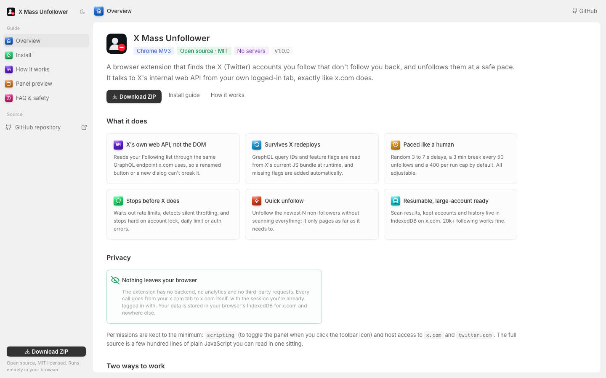
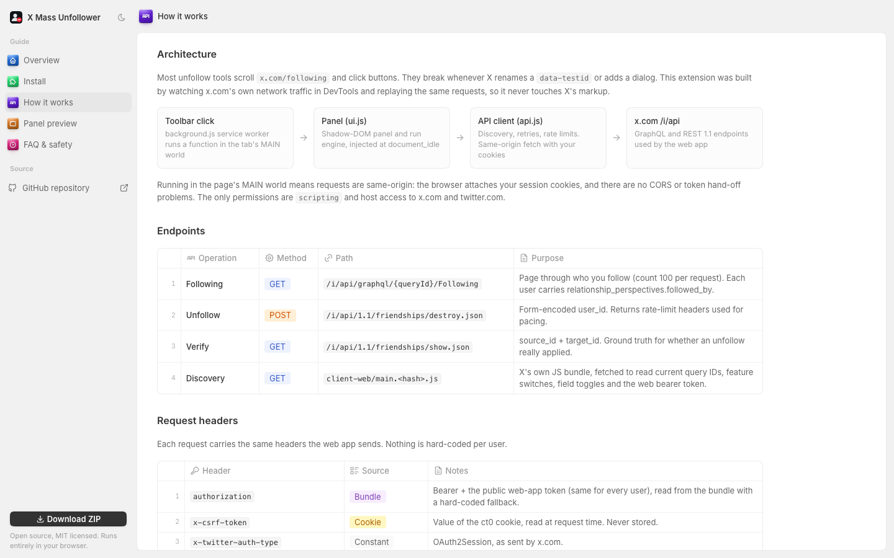

# X Mass Unfollower

An open-source Chrome extension (Manifest V3) that finds the X (Twitter) accounts you follow that don't follow you back, and unfollows them at a safe pace.

It talks to **X's internal web API** from your own logged-in x.com tab, the same requests x.com makes, instead of scrolling pages and clicking buttons. There are no servers, analytics or third parties.

**Website and docs:** https://alexisbcz.github.io/x-mass-unfollower/



## Features

- **API-based, not DOM-based.** Reads your Following list through X's GraphQL `Following` operation and unfollows through `friendships/destroy`. Renamed buttons or new dialogs can't break it.
- **Survives X redeploys.** GraphQL query IDs, feature switches and the web bearer token are read at runtime from X's current JS bundle, with hard-coded fallbacks.
- **Self-repairing requests.** When X rejects a request because a new feature flag is missing, the flag is added and the request retried. A stale query ID triggers rediscovery.
- **Rate-limit aware.** On HTTP 429 or error 88 it sleeps until `x-rate-limit-reset`. It also waits when `x-rate-limit-remaining` runs out instead of hitting the wall.
- **Silent-throttle detection.** X can return `200 OK` without applying an unfollow. Every N unfollows the extension checks the relationship. If the unfollow didn't stick, it cools down (15 min, then 30 min) and stops on the third strike.
- **Hard stops** on account lock (326), daily limit (344), suspension (64), auth failure (32, 215, HTTP 401), or 5 failures in a row.
- **Quick unfollow.** Unfollow the newest N non-followers without scanning everything: it only pages as far as it needs.
- **Full scan and review.** Filter, sort, keep accounts forever, auto-keep verified or popular accounts, export CSV, then unfollow with pause, resume and stop.
- **Resumable.** State lives in IndexedDB on x.com, so you can close the tab and continue later. Accounts following 20k+ work fine.

## Install

The extension isn't on the Chrome Web Store. Load it unpacked:

1. [Download the ZIP](https://github.com/alexisbcz/x-mass-unfollower/archive/refs/heads/main.zip) and unzip it, or `git clone https://github.com/alexisbcz/x-mass-unfollower.git`.
2. Open `chrome://extensions` and turn on **Developer mode**.
3. Click **Load unpacked** and select the **`extension`** folder.
4. Pin the icon, log in to x.com and click it to open the panel.

Works in any Chromium-based browser: Chrome, Chromium, Brave, Edge, Arc, Helium.

## Usage

Click the toolbar icon. It opens x.com if needed, then toggles the panel.

- **Quick unfollow:** enter a number (for example 100) and click **Quick unfollow**. It walks your Following list newest-first and unfollows non-followers as it finds them, skipping accounts you marked **Keep**.
- **Full scan, then review:** click **Full scan**, review the **Not following back** tab (everything is pre-selected), keep the accounts you want, then click **Unfollow N**.

Pacing defaults, all editable under *Pacing & safety settings*:

| Setting | Default |
|---|---|
| Random delay between unfollows | 3–7 s |
| Break | 3 min every 50 unfollows |
| Max per run | 400 |
| Verify the unfollow stuck | every 10 |

X's documented unfollow limit is about 187 per 15 minutes and the undocumented daily limits are lower. For a big cleanup, spread it over several days and stay under roughly 400 a day.

## How it works

The extension was built by inspecting x.com's own network traffic and replaying the same requests from the page:

| Step | Endpoint |
|---|---|
| List who you follow, with a `followed_by` flag per account | `GET /i/api/graphql/{queryId}/Following` |
| Unfollow | `POST /i/api/1.1/friendships/destroy.json` |
| Check that an unfollow actually applied | `GET /i/api/1.1/friendships/show.json` |
| Discover query IDs, feature switches and the web bearer token | X's `client-web/main.<hash>.js` bundle |

Content scripts run in the page's MAIN world, so requests are same-origin and carry your existing session cookies. The CSRF header is read from the `ct0` cookie at request time and never stored. The website has a [detailed technical walkthrough](https://alexisbcz.github.io/x-mass-unfollower/#/how-it-works) covering discovery, self-repair, pagination, every error code the client handles, and the state model.



## Project structure

```
extension/              The Chrome extension. Load this folder unpacked.
  manifest.json         MV3 manifest
  src/background.js     Toolbar click: open x.com or toggle the panel
  src/api.js            X web API client: discovery, retries, rate limits (MAIN world)
  src/ui.js             Shadow-DOM panel and run engine (MAIN world)
  icons/
site/                   Project website: Vite + React + TypeScript + twenty-ui
.github/workflows/      Builds the site and deploys it to GitHub Pages
docs/                   README screenshots
```

The extension is plain JavaScript with no dependencies and no build step.

To work on the website:

```sh
cd site
bun install
bun run dev      # local dev server
bun run build    # static build in site/dist
```

## Privacy

Nothing leaves your browser. The extension makes no requests except to x.com (and X's own JS bundle), has no backend and collects no telemetry. Scan results, kept accounts and settings are stored in your browser's IndexedDB for x.com. Permissions: `scripting`, plus host access to `x.com` and `twitter.com`.

## Disclaimer

This is an unofficial project, not affiliated with or endorsed by X Corp. It uses X's private, undocumented web API, which can change at any time, and using it may violate X's Terms of Service. Mass-unfollowing can trigger rate limits, temporary locks or other account restrictions. You use this software at your own risk and are solely responsible for how you use it.

## Contributing

Issues and pull requests are welcome. See [CONTRIBUTING.md](CONTRIBUTING.md). For security issues, see [SECURITY.md](SECURITY.md).

## License

[MIT](LICENSE) © 2026 Alexis Bouchez
